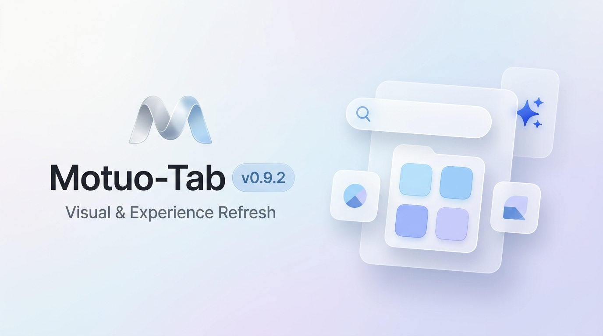
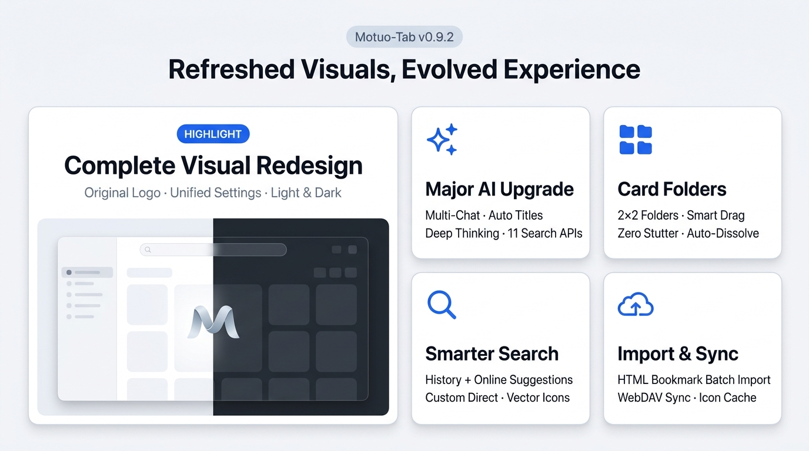
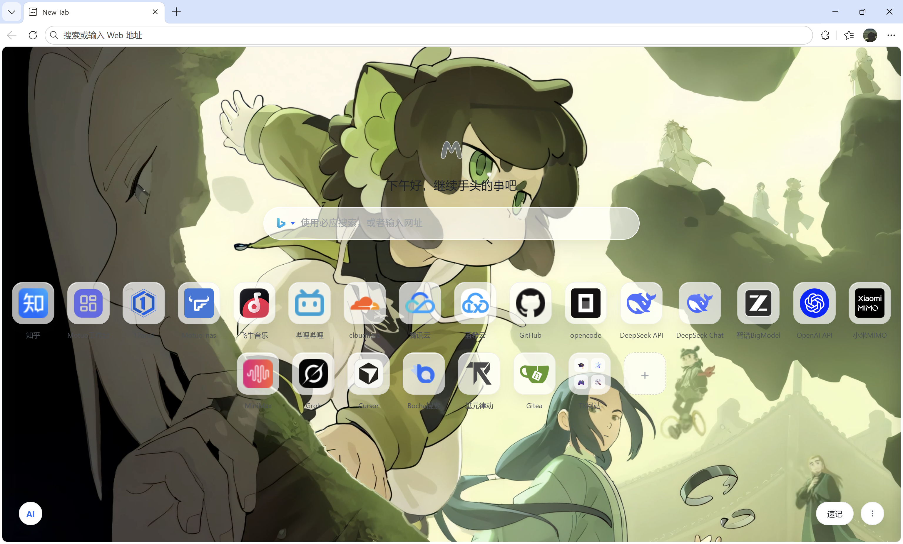
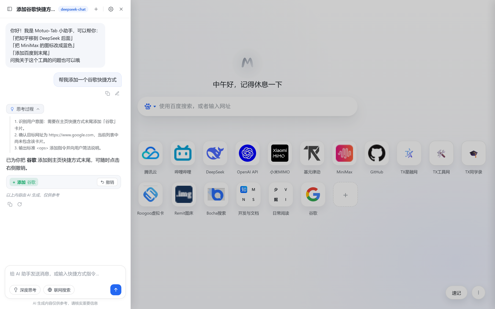
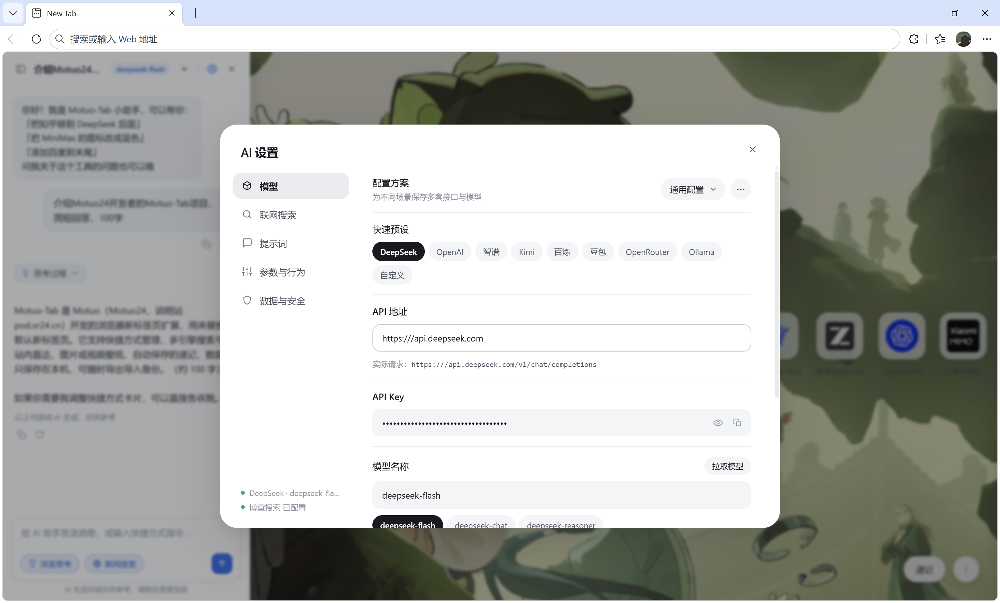
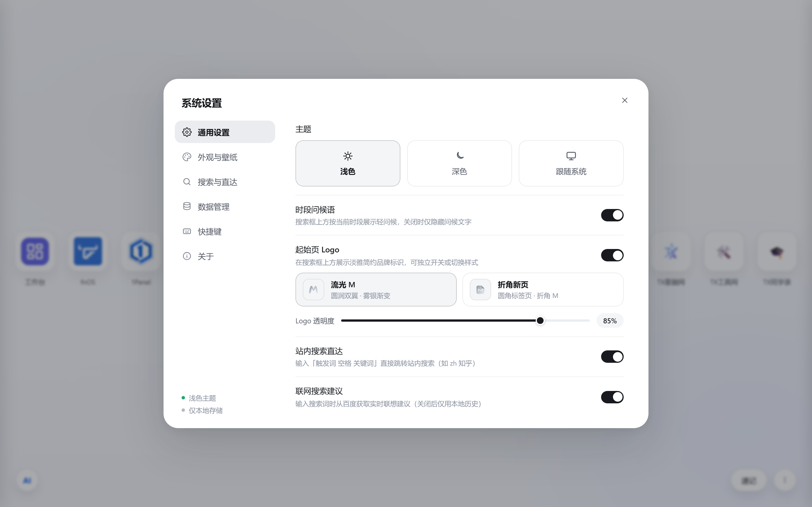

# Motuo-Tab

A browser New Tab replacement page: shortcut & folder management, personalized wallpapers, an AI assistant, a scratchpad, and cloud sync.

[中文](README.md) · [English](README-en.md)

> All data is stored locally in your browser (LocalStorage / IndexedDB) — **no backend required**.
> The extension, single-file, and online builds share identical core features, and you can optionally sync settings across devices via your own WebDAV server.
>
> ⚠️ **Exception: the AI assistant (including web search) and cross-origin WebDAV requests only work reliably in the browser extension build.** Opening the single-file HTML via `file://` lacks extension host permissions, so browsers block cross-origin requests. Use the **extension**, or serve it via an online host / local `http` server.

---

<p align="center">
  
</p>

<p align="center">
  
</p>

<details>
<summary>Expand full v0.9.2 highlights (complete history in <a href="CHANGELOG.md">CHANGELOG.md</a>)</summary>

- **Visuals & Themes**: Switchable dual-style original SVG logos (`Flowing M` / `Folded Page`), independent toggle & `20%–100%` opacity slider; time-of-day greetings; 6-tab System Settings dialog with large About view; Light / Dark / System Auto modes; transparent vector SVG icons for Baidu, Bing, and Google.
- **Folders & Editing**: 2×2 thumbnail folders and centered folder modal; gap-line insertion sorting, highlighted folder drop badge, and 450ms hover-to-merge folder creation; open/manage/reorder/drag-out folders directly in edit mode; auto-dissolve at 1 item and auto-remove when emptied.
- **AI Assistant & Settings**: Embedded multi-conversation drawer (Today / 7 Days / Older), model-generated session titles with customizable title prompt; copy / inline edit-and-resend / regenerate; timed reasoning accordion & integrated action/undo bar; 5-tab settings window with model profiles, `/v1/models` fetch, 11 search providers + custom endpoint, 3-layer prompt previews, and masked keys / sanitized exports.
- **Search, Import & Sync**: Local-first + Baidu online suggestions (`↑↓`/`Enter`/`Esc`, privacy toggle), search history manager & customizable site-direct prefixes; Chrome / Edge / Firefox HTML bookmark importer with tree preview; WebDAV cloud sync (merge/overwrite, excludes wallpapers & credentials), 30-day backup reminders, and 7-day background IndexedDB icon refresh.

</details>

## Screenshots

| Home | AI Sidebar |
| --- | --- |
|  |  |

| AI Settings | System Settings |
| --- | --- |
|  |  |

---

## Features

- **Search**: Baidu / Bing / Google (transparent vector SVG icons) and custom engines (`%s` templates); local history + Baidu online suggestions (keyboard navigation, toggleable); customizable site-direct rules (default `zh` / `gh` / `bl` / `tb` / `db`) and search history management.
- **Shortcuts & Folders**: Add, edit, delete, context menu, and automatic favicon caching in IndexedDB; 2×2 thumbnail folders with smart gap reordering, drop-into-folder, hover-to-merge folder creation, drag-to-bottom delete, in-folder reordering/drag-out, and auto-dissolve/auto-clean when sparse or empty.
- **Personalization**: Switchable startpage Hero logos (independent toggle & opacity control) and time-of-day greetings; image / video (MP4 / WebM) / animated (GIF / WebP) / solid-color wallpapers, blur control, card opacity, and Light / Dark / System Auto themes.
- **AI Assistant**: OpenAI-compatible streaming/non-streaming chat, multi-session drawer with model-generated titles, timed reasoning accordion, 11 web search providers with multi-round search, 3-layer custom prompts, and natural-language card/folder management with one-click undo.
- **Scratchpad**: Quick notes auto-saved locally.
- **Backup & Sync**: Full JSON export/import (with optional API key sanitization), Netscape bookmark HTML import, WebDAV cloud sync, and 30-day backup reminders.

## Installation

Currently supports Chromium-based browsers (Chrome / Edge, etc.). Firefox users can use the "Single-file HTML" method; to point the new tab directly at a local file, see the AutoConfig tutorial below.

### Release download (recommended)

Download the latest extension package from [Releases](../../releases), unzip it, and install in Chrome / Edge:

1. Open `chrome://extensions` (Edge: `edge://extensions`)
2. Enable "Developer mode" in the top-right corner
3. Click "Load unpacked" and select the unzipped `extension` folder

New tabs will now show Motuo-Tab.

> ⚠️ **Keep the unzipped `extension` folder safe — it IS the extension.**
> "Load unpacked" does not copy files into the browser; the browser only references
> this folder. Deleting, moving, or renaming it will break the extension.
> Unzip it to a long-term, fixed location (e.g. `D:\Motuo-Tab\`).

**Updating & data safety**:

- To update: unzip the new version **over the same path** (keep the folder's absolute path unchanged), then click the reload icon on the extension card — no reinstall needed;
- Your data (shortcuts, AI config & history, etc.) lives in the browser's local storage, bound to the extension ID. For unpacked extensions the ID is derived from the folder's **absolute path** — once the path changes, the browser treats it as a brand-new extension and old data becomes unreachable. So never move or delete the folder.

### Single-file HTML (no installation)

Download the single-file `newtab.html` from [Releases](../../releases) and double-click to use it. You can also set it as your new tab page:

- Edge: Settings → On startup → Open specific pages → add the file
- Chrome: needs an extension such as "New Tab Redirect" pointing to the file
- Other browsers (e.g. Firefox): just use the single file

### Firefox: Point the new tab to a local HTML via AutoConfig

Firefox does not allow pointing the new tab page at a local `file://` path and has no built-in setting for it. Using Mozilla's official **AutoConfig** mechanism (written into the Firefox install directory, bypassing extension caching) is currently the only way to point the new tab directly at a local `file://` path. The following applies to Firefox 136 and later.

**Step 1: open the `defaults/pref/` folder inside the Firefox install directory**

- Windows: `C:\Program Files\Mozilla Firefox\defaults\pref`
- macOS: `/Applications/Firefox.app/Contents/Resources/defaults/pref/` (adjust to your actual system path)
- Linux: `/opt/firefox/defaults/pref/`

Create `autoconfig.js` with:

```ini
pref("general.config.filename", "mozilla.cfg");
pref("general.config.obscure_value", 0);
pref("general.config.sandbox_enabled", false);
```

**Step 2: go back to the Firefox install root (the parent of `defaults`) and create `mozilla.cfg`**

The first line must be a comment (a hard requirement of Firefox, otherwise the whole file is ignored):

```js
// My new tab
try {
  const ff = {};
  ChromeUtils.defineESModuleGetters(ff, {
    AboutNewTab: "resource:///modules/AboutNewTab.sys.mjs"
  });
  ff.AboutNewTab.newTabURL = 'file:///C:/path/to/your/index.html';
} catch (e) {
  ChromeUtils.reportError(e);
}
```

Replace `file:///C:/path/to/your/index.html` with the real absolute path of your local HTML (same on Linux/macOS, e.g. `file:///home/you/index.html`).

**Step 3: restart Firefox and press `Ctrl+T`** to verify the new tab now points to the file.

### Online preview / use

Visit <https://xr24.cn/motuo-tab-online/> directly — no installation needed. Data still stays in your local browser (LocalStorage / IndexedDB).

### Manual build (for developers)

```bash
npm install
npm run build
```

Artifacts: `dist/newtab.html` (single-file) and `dist/extension` (MV3 extension).

## Usage

### Keyboard shortcuts

| Shortcut | Action |
| --- | --- |
| `Ctrl+E` | Focus mode (content fades out, search box centers) |
| `Ctrl+K` | Edit mode (gap reorder / drag or hover into folder / manage folders / drag to bottom to delete) |
| `Ctrl+A` | Open AI assistant |
| `Esc` | Close modals / menus |

### Site-direct search

Type "prefix + space + keyword" in the search box to search directly on a site (customizable under System Settings → Search & Direct):

| Default prefix | Site |
| --- | --- |
| `zh` | Zhihu |
| `gh` | GitHub |
| `bl` / `b站` | Bilibili |
| `tb` | Taobao |
| `db` | Douban |

Example: `bl Node.js` → search Node.js on Bilibili.

### AI assistant

1. Click the `AI` button in the bottom-left corner to open the sidebar (open the history drawer on the top-left or start a new chat on the top-right)
2. Click `⚙` in the top-right to open the standalone settings dialog: configure OpenAI-compatible API endpoint, key, model profiles, 11 web search providers (or custom endpoint), and 3-layer prompts (System / Context / Title)
3. Toggle "Web search" or "Deep thinking" above the input box as needed

Manage shortcuts and folders in natural language, e.g. "make GitHub green" or "move Zhihu into Reading folder"; operations can be undone individually.

> **Note**: the AI assistant needs to make cross-origin requests to the model endpoint and search APIs, so it **only works reliably in the browser extension build** (the extension declares `<all_urls>` host permissions). Opening `dist/newtab.html` via `file://` lacks such permissions and requests will be blocked; serve it over a local `http` server or an online host (`http/https`) if needed.

### Data & sync

- **Export / Import / Bookmarks / WebDAV**: bottom-right menu → System Settings → Data Management for full JSON backups (optionally excluding API keys), browser bookmark HTML imports, manual icon cache refresh, and WebDAV cloud sync.
- **Local storage**: `localStorage` stores settings, shortcuts, folders, and multi-session AI history; `IndexedDB` stores wallpapers and cached icons; the full key inventory is documented in `src/index.html`.

## Development

```bash
npm install        # install dependencies
npm run build      # build artifacts to dist/ (single-file + extension)
npm test           # run tests (requires build first)
npm run gen:icons  # regenerate extension icons
```

## Directory structure

```
src/                  # source code
  index.html          # page template (external CSS/JS)
  styles/main.css     # styles
  scripts/search.js   # search module (engines/suggestions/history/site-direct)
  scripts/main.js     # main module (cards/folders/wallpaper/theme/scratchpad/bookmarks/WebDAV)
  scripts/ai-search.js# AI multi-provider web search adapter
  scripts/ai.js       # AI assistant & multi-session chat
  scripts/idle.js     # idle-hide UI module
  assets/             # default icon source images (inlined during build)
  favicon.ico
scripts/              # build tooling
  build.js            # single-file + MV3 extension
  split-source.js     # legacy single-file → src/ migration tool
  gen-icons.js        # generate extension icons
tests/                # jsdom regression tests
dist/                 # build output (gitignored)
```

## License

[MIT](LICENSE) © 2026 Motuo24
