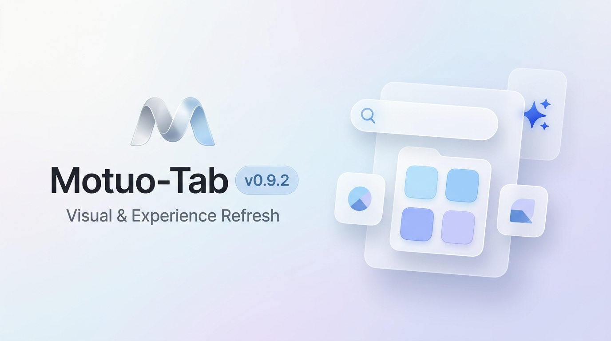
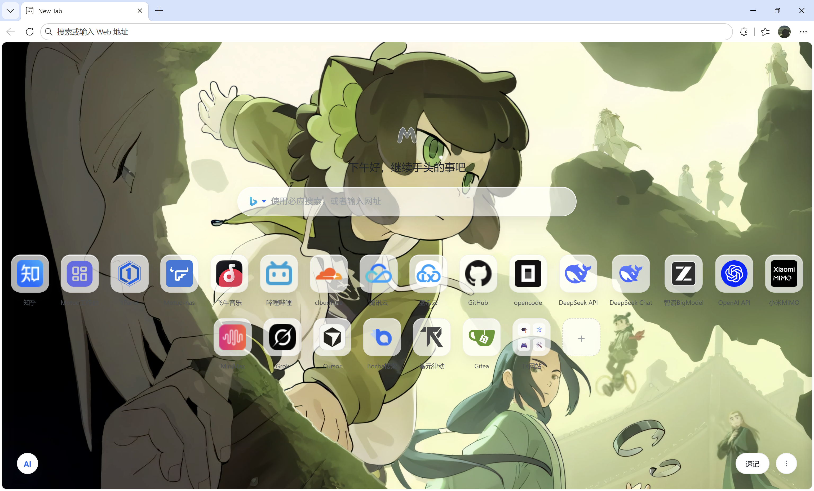
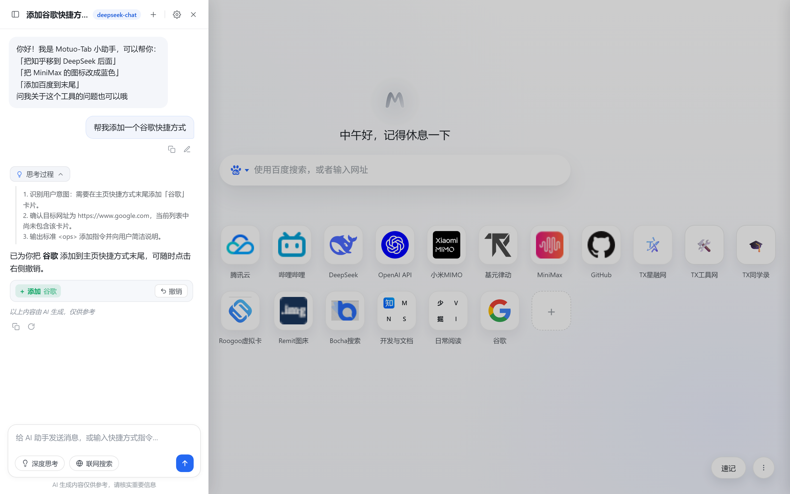
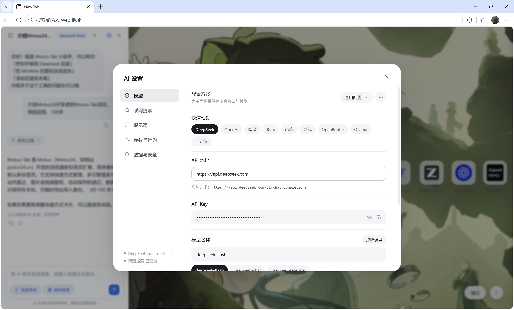
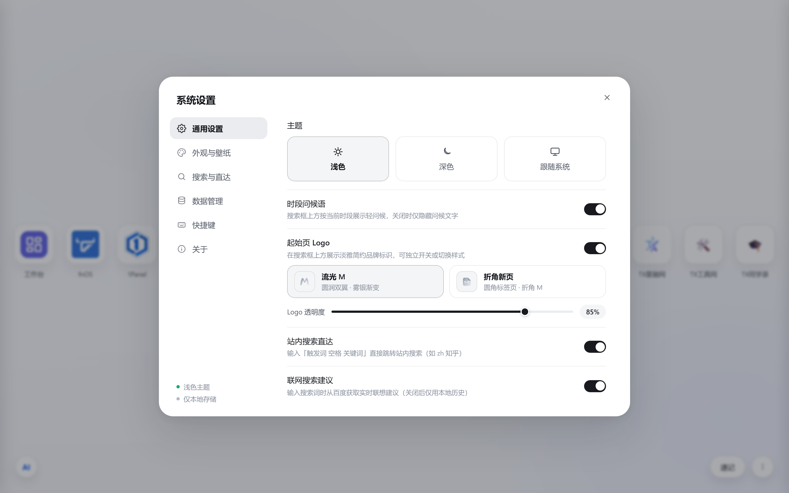

# Motuo-Tab

浏览器新标签页（New Tab）替换页：快捷方式与分组管理、个性化壁纸、AI 助手、速记本与云同步。

[中文](README.md) · [English](README-en.md)

> 数据全部保存在浏览器本地（LocalStorage / IndexedDB），**不依赖任何后端**。
> 无论使用扩展版、本地单文件版还是在线版，核心功能完全一致；也支持通过自备 WebDAV 跨设备同步配置。
>
> ⚠️ **例外：AI 助手（含联网搜索）与部分跨域 WebDAV 接口仅在安装为浏览器扩展时完整可用。** 用 `file://` 直接打开本地单文件版时，页面没有扩展的 host 权限，浏览器会拦截跨域请求。请使用**扩展版**，或通过在线版 / 本地 http 服务器访问。

---

<p align="center">
  
</p>

<p align="center">
  
</p>

<details>
<summary>展开查看 v0.9.2 详细特性清单（完整历史见 <a href="CHANGELOG.md">CHANGELOG.md</a>）</summary>

- **视觉与主题**：原创双款式 Brand Logo（`流光 M` / `折角新页`）、独立开关与 `20%–100%` 透明度调节；早中晚轻问候；6 栏「系统设置」单窗与大版面「关于」页；浅色 / 深色 / 跟随系统三态切换；百度 / 必应 / 谷歌透明底高清矢量 SVG 图标。
- **分组与编辑**：2×2 缩略图分组卡片与居中弹窗；缝隙竖线插入排序、分组主体高亮胶囊提示移入、普通卡悬停 450ms 自动合并建组；编辑态可直接点开分组，组内拖拽排序与拖出回主页；剩 1 项自动解散、移空自动消失。
- **AI 助手与配置**：内嵌式多对话抽屉（今天 / 7 天内 / 更早）、首轮自动生成会话标题与自定义标题提示词；复制 / 原地编辑重发 / 重新回答；计时深度思考折叠与一体化操作撤销栏；5 栏独立配置窗、多套模型方案、`/v1/models` 拉取、11 家联网搜索及自定义接口、三层提示词预览、密钥掩码与脱敏备份。
- **搜索、导入与同步**：搜索建议本地历史优先 + 百度联网联想（`↑↓`/`Enter`/`Esc` 导航、隐私开关）、搜索历史管理与自定义站内直达；Chrome / Edge / Firefox 书签 HTML 预览导入（自动建组）；WebDAV 云同步（合并/覆盖，排除壁纸与凭证）、30 天备份提醒与 IndexedDB 7 天周期图标缓存。

</details>

## 预览

| 主页 | AI 侧边栏 |
| --- | --- |
|  |  |

| AI 设置 | 系统设置 |
| --- | --- |
|  |  |

---

## 功能

- **搜索**：百度 / 必应 / 谷歌（透明底矢量图标）与自定义引擎（`%s` 模板）；本地历史优先 + 百度联网联想（键盘导航、可关闭）；可自由增删的站内直达规则（默认 `zh` / `gh` / `bl` / `tb` / `db`）与搜索历史管理。
- **快捷方式与分组**：增删改、右键菜单、自动抓取并缓存图标至 IndexedDB；支持 2×2 缩略图分组文件夹、编辑模式智能缝隙排序 / 拖入分组 / 悬停合并建组 / 拖到底部删除，以及组内拖拽排序、拖出回主页与自动解散/清理。
- **个性化与外观**：支持原创双款式起始页 Logo（可调透明度与独立开关）与时段问候语；图片 / 视频（MP4 / WebM）/ 动图（GIF / WebP）/ 纯色壁纸、模糊度、卡片透明度（图标 / 文字独立控制）及浅色 / 深色 / 跟随系统主题。
- **AI 助手**：OpenAI 兼容接口流式/非流式对话，内嵌多对话抽屉与模型自动命名、带计时深度思考折叠、11 家联网搜索及多轮搜索、三层自定义提示词、自然语言管理卡片与分组并按次撤销。
- **速记本**：随手记录，自动保存至本地。
- **备份与云同步**：支持完整 JSON 导出 / 导入（可选脱敏排除 API 密钥）、浏览器书签 HTML 批量导入、WebDAV 云同步（合并或覆盖）与 30 天备份提醒。

## 安装

目前仅支持 Chromium 内核浏览器（Chrome / Edge 等）。Firefox 用户请用「单文件 HTML」；如需把新标签页直接指向本地文件，见下方 AutoConfig 教程。

### 发行版下载（推荐）

从 [Releases](../../releases) 下载最新版扩展压缩包，解压后在 Chrome / Edge 中安装：

1. 打开 `chrome://extensions`（Edge 用 `edge://extensions`）
2. 开启右上角「开发者模式」
3. 点「加载已解压的扩展程序」，选择解压后的 `extension` 文件夹

之后新开标签页即是 Motuo-Tab。

> ⚠️ **请妥善保管解压出来的 `extension` 文件夹，它就是扩展本体。**
> 「加载已解压的扩展程序」不会把文件复制进浏览器，浏览器只是引用这个文件夹；
> 删除、移动或重命名它都会让扩展失效。建议解压到一个长期固定的位置（如 `D:\Motuo-Tab\`）。

**更新与数据安全**：

- 更新版本：把新版解压**覆盖到同一路径**（保持文件夹的绝对路径不变），再到扩展管理页点一下「刷新」即可，无需重装；
- 数据（快捷方式、AI 配置与历史等）保存在浏览器本地存储中，与扩展 ID 绑定；而「未打包扩展」的 ID 由文件夹的**绝对路径**决定——路径一变，浏览器会视为一个全新的扩展，旧数据将无法读取。因此请勿更改文件夹位置，更不要删除它。

### 单文件 HTML（免安装）

从 [Releases](../../releases) 下载单文件版 `newtab.html`，双击打开即用；也可设为浏览器新标签页：

- Edge：设置 → 启动时 → 打开特定页面 → 添加该文件
- Chrome：配合「New Tab Redirect」等扩展指向该文件
- 其他浏览器（如 Firefox）：直接用单文件即可

### Firefox：AutoConfig 设置新标签页指向本地 HTML

Firefox 默认不允许把新标签页指向本地 `file://` 路径，且无内置设置项。通过 Mozilla 官方的 **AutoConfig** 机制（写在 Firefox 安装目录里，不经过扩展缓存），是目前唯一能直接让新标签页指向本地 `file://` 路径的办法。以下针对 Firefox 136 及以上版本。

**第一步：进入 Firefox 安装目录下的 `defaults/pref/` 文件夹**

- Windows：`C:\Program Files\Mozilla Firefox\defaults\pref`
- macOS：`/Applications/Firefox.app/Contents/Resources/defaults/pref/`（按你系统实际情况）
- Linux：`/opt/firefox/defaults/pref/`

新建文件 `autoconfig.js`，内容：

```ini
pref("general.config.filename", "mozilla.cfg");
pref("general.config.obscure_value", 0);
pref("general.config.sandbox_enabled", false);
```

**第二步：回到 Firefox 安装根目录（即 `defaults` 的上一级），新建 `mozilla.cfg`**

第一行必须是一行注释（这是 Firefox 的硬性要求，否则整个文件会被忽略）：

```js
// My new tab
try {
  const ff = {};
  ChromeUtils.defineESModuleGetters(ff, {
    AboutNewTab: "resource:///modules/AboutNewTab.sys.mjs"
  });
  ff.AboutNewTab.newTabURL = 'file:///C:/path/to/your/index.html';
} catch (e) {
  ChromeUtils.reportError(e);
}
```

把 `file:///C:/path/to/your/index.html` 换成本地 HTML 的真实绝对路径（Linux/macOS 同理，写成 `file:///home/you/index.html` 这类格式）。

**第三步：重启 Firefox，按 `Ctrl+T` 验证**新标签页已指向该文件。

### 在线使用 / 预览

直接访问 <https://xr24.cn/motuo-tab-online/> 即可使用，无需下载安装；数据仍存于本机浏览器（LocalStorage / IndexedDB）。

### 手动构建（开发者）

```bash
npm install
npm run build
```

产物：`dist/newtab.html`（单文件）与 `dist/extension`（MV3 扩展目录）。

## 使用

### 快捷键

| 快捷键 | 作用 |
| --- | --- |
| `Ctrl+E` | 专注模式（内容淡出、搜索框居中） |
| `Ctrl+K` | 编辑模式（缝隙排序 / 拖入或悬停建组 / 点击分组管理 / 拖到底部删除） |
| `Ctrl+A` | 打开 AI 助手 |
| `Esc` | 关闭弹窗 / 菜单 |

### 站内搜索直达

搜索框输入「前缀 + 空格 + 关键词」，直接跳到对应站点搜索（可在「系统设置 → 搜索与直达」自由增删规则）：

| 默认前缀 | 站点 |
| --- | --- |
| `zh` | 知乎 |
| `gh` | GitHub |
| `bl` / `b站` | B站 |
| `tb` | 淘宝 |
| `db` | 豆瓣 |

例：`bl Node.js` → 在 B 站搜索 Node.js。

### AI 助手

1. 点左下角 `AI` 按钮打开侧边栏（左上角可展开历史多对话抽屉，右上角可新建对话）
2. 点右上角 `⚙` 打开独立配置窗口：填写 OpenAI 兼容的 API 地址、密钥与模型，按需配置多套方案、11 家主流联网搜索服务（或自定义接口）及系统/上下文/标题三层提示词
3. 开启底部「联网搜索」或「深度思考」即可按需触发联网检索与思考折叠展示

支持自然语言管理快捷方式与分组，例如「把 GitHub 改成绿色」「把知乎归入阅读分组」，修改卡片后支持一键撤销。

> **注意**：AI 助手需要跨域请求模型与搜索 API，**仅在浏览器扩展版中完整可用**（扩展已声明 `<all_urls>` host 权限）。用 `file://` 打开 `dist/newtab.html` 时请求会被浏览器拦截；如使用单文件版，请通过本地 http 服务器或在线托管访问。

### 数据与同步

- **备份 / 恢复 / 书签导入 / 云同步**：右下角菜单 → 「系统设置 → 数据管理」，支持完整 JSON 备份（可选脱敏排除密钥）、浏览器书签 HTML 导入、手动更新图标缓存与 WebDAV 云同步。
- **本地存储结构**：`localStorage` 保存配置、快捷方式、分组与多对话历史；`IndexedDB` 保存壁纸文件与图标缓存；完整键位清单见 `src/index.html` 头部注释。

## 开发

```bash
npm install        # 安装依赖
npm run build      # 构建产物到 dist/（单文件 + 扩展目录）
npm test           # 运行测试（需先 build）
npm run gen:icons  # 重新生成扩展图标
```

## 目录结构

```
src/                  # 源码
  index.html          # 页面模板（外链 CSS/JS）
  styles/main.css     # 样式
  scripts/search.js   # 搜索模块（引擎/建议/历史/站内直达）
  scripts/main.js     # 主模块（卡片/分组/壁纸/主题/速记/书签导入/WebDAV）
  scripts/ai-search.js# AI 多源联网搜索适配层
  scripts/ai.js       # AI 助手与多对话管理
  scripts/idle.js     # Idle 隐藏 UI
  assets/             # 默认图标原图，构建时内联进脚本
  favicon.ico
scripts/              # 构建工具
  build.js            # 单文件 + MV3 扩展
  split-source.js     # 旧单文件 → src/ 迁移工具
  gen-icons.js        # 生成扩展图标
tests/                # jsdom 回归测试
dist/                 # 构建产物（gitignore）
```

## 许可证

[MIT](LICENSE) © 2026 Motuo24
